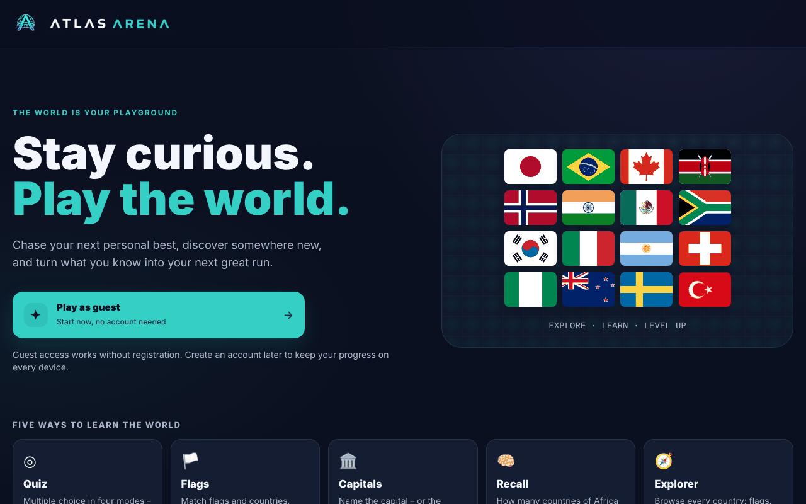
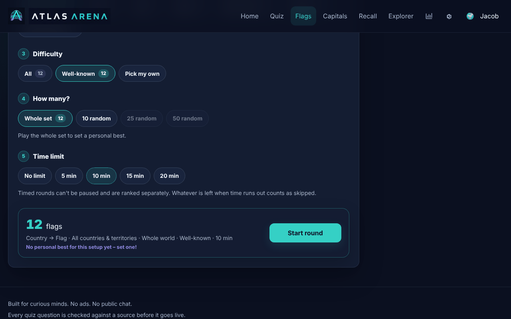
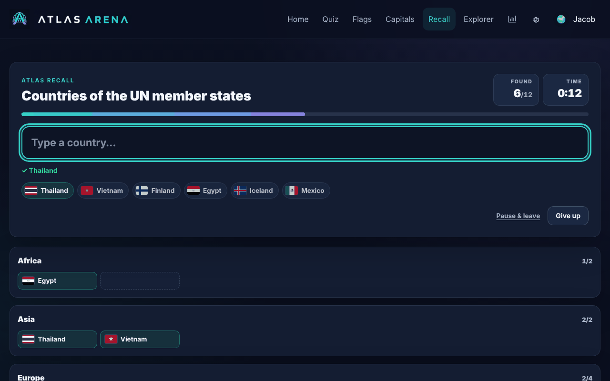
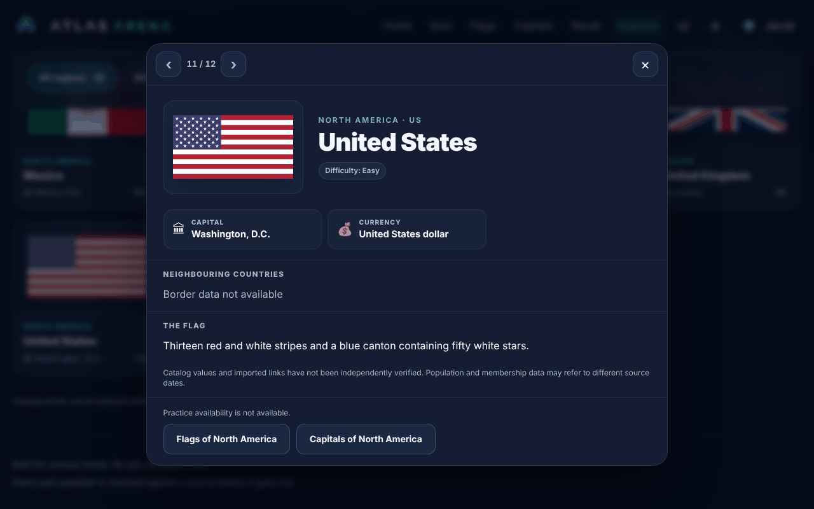
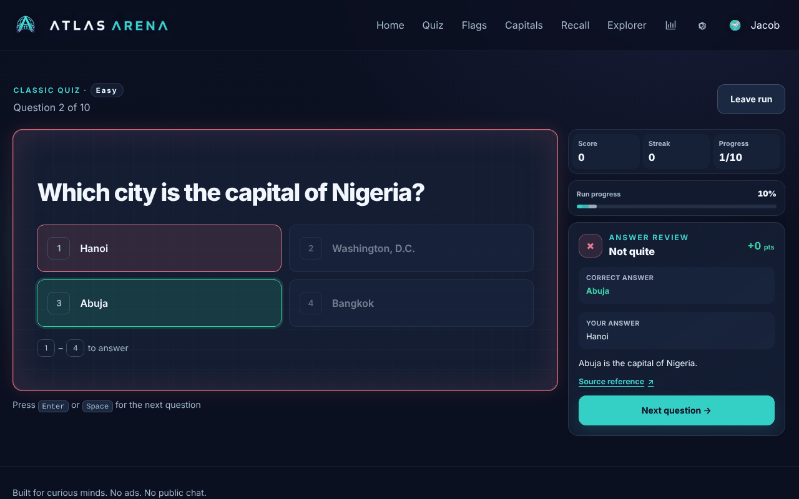
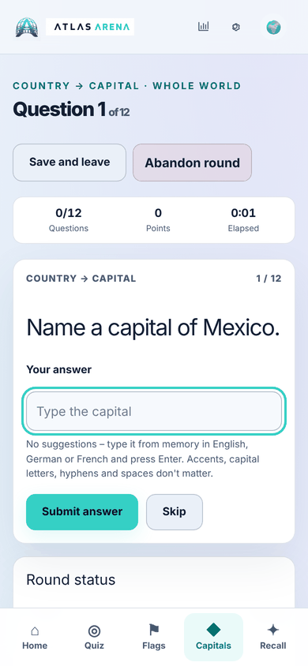

# Atlas Arena

**Learn the world through play.** Atlas Arena is a geography game for the browser and phone: find countries in a
searchable atlas, learn them in focused games, and come back to beat your own records.



## What you can play

| Game | What you do |
|---|---|
| **Quiz** | Multiple-choice questions in four modes – Classic (10 questions), Practice, Timed (60 s) and Endless (three lives, harder every five correct answers) – across four difficulty tiers and many topics |
| **Flags** | See a country and pick its flag, or see a flag and type the country. Region hints when you're stuck |
| **Capitals** | Name the capital – or the country behind it – from memory. No suggestions while you type |
| **Recall** | How many countries of Africa can you name? Type every place in a set; each correct answer drops into place |
| **Elimination** | Four colour chains of clues (after JetPunk's *Category Elimination*): every place you name must fit all clues shown so far, until one place is left. 24 puzzles – 8 easy, 8 medium, 8 hard |
| **Explorer** | Browse every country and territory: flag, capital, population, area, languages, currency and clickable neighbours |

Answers in Capitals, Recall, Elimination and the mistake review are accepted in **English, German or French** – accents, capital
letters, hyphens and spaces don't matter.

### One setup for Flags, Capitals and Recall

Every round is built from the same five choices: how to play, **UN member states or all countries & territories**
(so territories that share a flag, like Réunion, can be left out), a region, all / well-known / **your own picks**,
the whole set or 10 / 25 / 50 at random, and an optional **time limit** of 5–20 minutes.



### Reasons to come back

- **Daily challenge** – the same ten questions for everyone, one try per day, with a rank, a top 10 and a daily streak.
- **Review my mistakes** – everything you got wrong comes back until you answer it correctly once.
- **Personal bests** for every setup, **statistics** per game and **42 achievements** in bronze, silver, gold and platinum.
- **Levels and XP** from quiz games, plus a global leaderboard.
- Unfinished rounds are saved; continue them from Home or the game's setup.

| Recall | Explorer |
|---|---|
|  |  |

| Quiz feedback | On a phone |
|---|---|
|  |  |

Light and dark themes, a bottom tab bar on phones, keyboard shortcuts, optional vibration feedback and offline-ready
installation as a PWA.

## For administrators

- **Review queue** (`/admin`): check draft questions one at a time with their source, answers and explanation.
  Warnings flag general start-page sources, missing reference years and very short explanations.
- **Edit in place**: admins see *Edit question* while playing a quiz and on the results page.
- **Question studio**: search, filter, inspect and import questions (validated JSON, dry run first).

A question only goes live after a person ticks that they checked it against its source – nothing is published
automatically, in bulk or by scripts.

## How it's built

| Part | Technology |
|---|---|
| App | React 18, TypeScript, React Router, Tailwind CSS, Vite; installable PWA |
| Backend | Supabase – Postgres with all game rules in `SECURITY DEFINER` functions, Auth (guests and email accounts), one Edge Function (`delete-account`) |
| Hosting | Vercel (static frontend) |
| Tests | Vitest + Testing Library, Playwright end-to-end, backend tests against a disposable Supabase project |

The server decides every score, best and badge; the browser only shows the game. Answers are never sent to the
browser before they are needed (Recall uses salted hashes of the accepted spellings).

### Project layout

| Path | What's there |
|---|---|
| `src/api.ts` | The only module that talks to Supabase; every call also has a local demo branch |
| `src/game-setup.tsx` | The shared setup screen, personal bests, timer and round tags |
| `src/Quiz.tsx`, `src/Flags.tsx`, `src/Capitals.tsx`, `src/Recall.tsx`, `src/Elimination.tsx`, `src/Explorer.tsx` | The games |
| `src/Hub.tsx`, `src/Today.tsx`, `src/Review.tsx`, `src/Statistics.tsx`, `src/Achievements.tsx`, `src/Leaderboard.tsx` | Home, daily challenge, mistake review, statistics, achievements and leaderboard |
| `src/icons.tsx` | The app's SVG icon set and per-game accent colours |
| `src/Admin.tsx`, `src/AdminReview.tsx`, `src/QuestionEditor.tsx` | Admin tools |
| `src/*-domain.ts`, `src/*demo*.ts` | Pure, unit-tested game logic and the device-local demo engines |
| `supabase/migrations/` | The schema and every server function – the only source of truth for the database |
| `content/`, `scripts/` | Draft questions, their provenance and the generators |

## Run it locally

```bash
npm install
npm run dev
```

With no Supabase variables set, the app runs as a **local demo**: a small set of sample countries and questions,
progress kept in the browser, nothing uploaded. The daily challenge, mistake review, achievements and admin tools
need a real Supabase project.

To connect a Supabase project, copy `.env.example` to `.env.local`, fill in `VITE_SUPABASE_URL` and
`VITE_SUPABASE_ANON_KEY`, and restart. Never put a service-role key into a `VITE_` variable.

For a local Supabase: `supabase start`, then `supabase db reset`, and use the local URL and anon key.

## Database changes

Every schema or function change is a new timestamped file in `supabase/migrations/`, applied with
`supabase db push` (after `supabase link --project-ref …`). Never edit an applied migration or change the hosted
database by hand.

## Content

The country catalog powers Explorer, Flags, Capitals and Recall. Quiz questions are separate:

- Drafts are generated from the catalog (`scripts/generate_quiz_questions.py`) or written by hand, and imported as
  drafts through the admin tools.
- A question is playable only when it is reviewed, its source is verified and it has a review date – set by the
  person who checked it. `content/PROVENANCE.md` explains where the data comes from.
- German and French spellings for Recall and Capitals come from a curated alias table.

Admin access is granted with `"atlas_admin": true` in the user's `auth.users.raw_app_meta_data`; profile fields
never grant admin rights.

## Scoring

**Quiz:** Easy 100 · Medium 125 · Hard 150 · Expert 200 points per correct answer, plus a streak bonus of
`min(50, 10 × (streak − 1))`. Finished non-practice games earn 20 XP + 10 XP per correct answer;
level = 1 + floor(XP / 500).

**Flags, Capitals, Recall:** one personal best per setup – more correct answers first, then the faster time. Random
samples are practice rounds and never count; timed rounds are ranked separately.

## Tests

```bash
npm test                  # unit and component tests
npm run test:e2e          # Playwright (run `npx playwright install chromium` once)
npm run test:integration  # backend tests – needs TEST_SUPABASE_* of a disposable project, never production
npm run build             # type check, production build and service worker
```

## Deployment

1. `supabase db push` for new migrations.
2. `supabase functions deploy delete-account --no-verify-jwt` with `APP_ORIGIN` set (the function checks the
   token itself).
3. Push to `main`; Vercel builds the frontend with the two public `VITE_SUPABASE_*` variables.
4. With a custom Supabase domain, update `connect-src` in the CSP in `vercel.json`.

Before a public launch: Auth rate limits and bot protection for guest sign-ups, leaked-password protection, SMTP for
confirmation emails, and a privacy notice with an operator contact.

## Privacy

- Players can download all their data (*Settings → Download my data*) and delete their account; deletion removes
  every game's records.
- No ads, tracking or analytics. The optional diagnostic log never leaves the device.
- Running Atlas Arena as a public service still needs a reviewed privacy notice, a retention policy and legal review.
